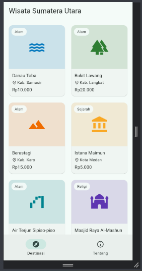
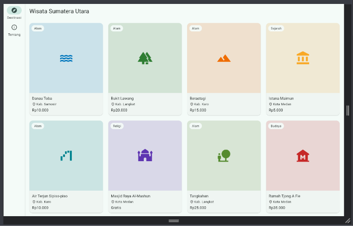
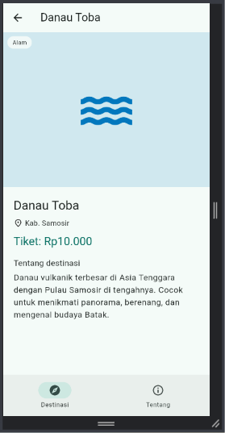
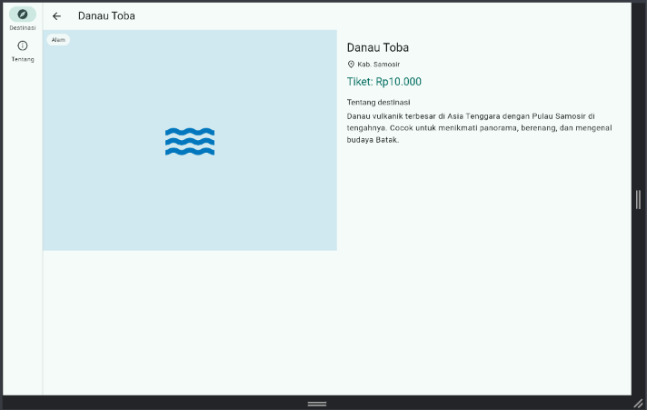

# Wisata Sumatera Utara (Responsif & Multi-Screen)

## A. Identitas

- Nama : Lastri P. Silaban
- NIM : 4243250037
- Kelas : PSIK-24C
- Mata Kuliah : Pemrograman Mobile (Tugas Rutin 6)
- Program Studi Ilmu Komputer, FMIPA, Universitas Negeri Medan

## B. Tangkapan Layar

| | Ponsel | Tablet / layar lebar |
|---|---|---|
| Daftar |  |  |
| Detail |  |  |

## C. Keputusan Responsif

Saya memakai dua alat responsif dengan peran berbeda. `MediaQuery.sizeOf` saya pakai di `KerangkaNavigasi` karena yang diputuskan adalah tata letak tingkat aplikasi, yaitu apakah navigasi berada di bawah (`NavigationBar`) atau di samping (`NavigationRail`). Batasnya 840 dp, mengikuti window size class Material Design 3 untuk layar expanded.

`LayoutBuilder` saya pakai di dalam halaman karena keputusan di sana bergantung pada ruang yang diberikan parent, bukan lebar seluruh layar. Pada halaman daftar, jumlah kolom grid mengikuti `constraints.maxWidth`: 2 kolom (< 600 dp), 3 kolom (< 900 dp), 4 kolom (< 1200 dp), dan 5 kolom (>= 1200 dp). Ketika `NavigationRail` tampil, lebar grid berkurang sekitar 80 dp, sehingga `LayoutBuilder` lebih akurat daripada `MediaQuery`. Pada halaman detail, batasnya 700 dp: di bawahnya gambar dan info tersusun vertikal dalam `ListView`, di atasnya berdampingan dalam `Row`.

Overflow dicegah dengan `Expanded`, `maxLines`, dan `TextOverflow.ellipsis` pada teks nama dan kabupaten, serta `SingleChildScrollView` pada panel info di layar lebar. Pengujian saya lakukan pada lebar 360 hingga 1280 dp.

## D. Penggunaan AI

Saya menggunakan AI untuk membantu menyusun kerangka kode awal, menjelaskan konsep layout responsif dan go_router, serta membantu menelusuri error saat `flutter analyze`. Kode sudah saya jalankan, uji di beberapa ukuran layar, dan pelajari sebelum dikumpulkan.